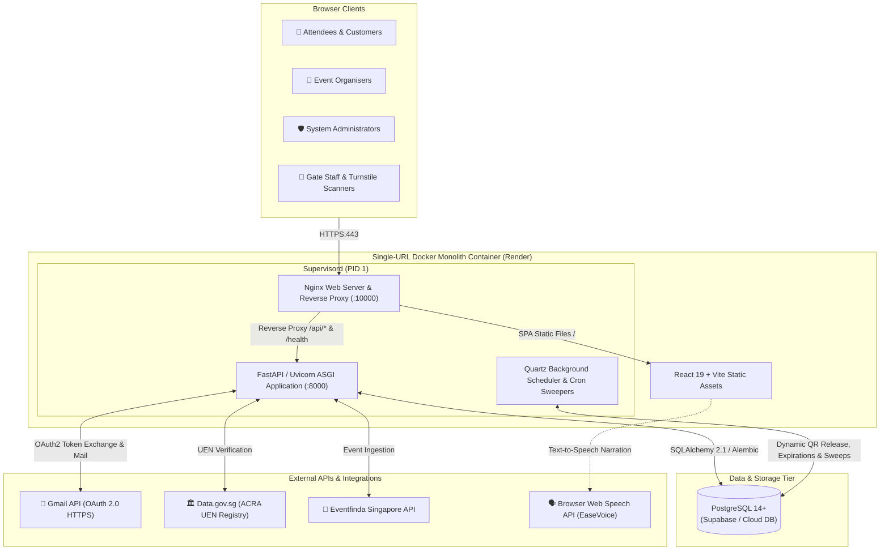

# EventEase 🎟️

[](https://react.dev/)
[](https://www.typescriptlang.org/)
[](https://vitejs.dev/)
[](https://tailwindcss.com/)
[](https://fastapi.tiangolo.com/)
[](https://www.python.org/)
[](https://www.postgresql.org/)
[](https://www.sqlalchemy.org/)
[](https://www.docker.com/)
[](https://render.com/)

**EventEase** is an accessible, enterprise-grade, full-stack event discovery, ticketing, and venue operations platform engineered for concerts, theatre, sports, and cultural festivals in Singapore. Built with a high-performance **React 19** frontend and a robust **FastAPI + PostgreSQL** backend, EventEase combines attendee accessibility with concurrency-safe reservations, dynamic anti-scalping QR releases, fair 1-to-1 peer-to-peer ticket exchanges (**EaseXchange** — *no secondary ticket resale or markups*), and multi-tenant organiser governance.

---

### 🌐 Live Production Deployment

EventEase is deployed as an enterprise single-container monolith on **Render**:

| Service | Endpoint | Description |
| :--- | :--- | :--- |
| **Live Web Platform** | [https://eventease-ggz2.onrender.com](https://eventease-ggz2.onrender.com) | Unified React 19 SPA & Public Portals |
| **Interactive API Docs** | [https://eventease-ggz2.onrender.com/api/docs](https://eventease-ggz2.onrender.com/api/docs) | OpenAPI / Swagger interactive documentation |
| **System Health Check** | [https://eventease-ggz2.onrender.com/health](https://eventease-ggz2.onrender.com/health) | Uvicorn & database connectivity probe |

---

## 📑 Table of Contents

- [Architectural Overview](#-architectural-overview)
- [Key Features & Capabilities](#-key-features--capabilities)
  - [1. Concurrency-Safe Seating & Ticketing Engine](#1-concurrency-safe-seating--ticketing-engine)
  - [2. Dynamic Anti-Scalping QR Release & Gate Scanner](#2-dynamic-anti-scalping-qr-release--gate-scanner)
  - [3. Inclusive Design: EaseVoice, EaseGuide & Adaptive UI](#3-inclusive-design-easevoice-easeguide--adaptive-ui)
  - [4. EaseXchange: 1-to-1 Fan Ticket Exchange (Pre-Sales-Close Only)](#4-easexchange-1-to-1-fan-ticket-exchange-pre-sales-close-only)
  - [5. Multi-Tenant Organisations, Venues & Team Operations](#5-multi-tenant-organisations-venues--team-operations)
  - [6. Enterprise Security, Fraud Guard & PDPA Compliance](#6-enterprise-security-fraud-guard--pdpa-compliance)
  - [7. Time-Travel Clock Simulation & Quartz Scheduler](#7-time-travel-clock-simulation--quartz-scheduler)
  - [8. Community Ecosystem: EaseConnect, EasePix, EaseXplore 360, EasePoints & EaseHelp](#8-community-ecosystem-easeconnect-easepix-easexplore-360-easepoints--easehelp)
- [Technology Stack](#-technology-stack)
- [Directory Structure](#-directory-structure)
- [Role-Based Access Control (RBAC)](#-role-based-access-control-rbac)
- [Quick Start & Local Development](#-quick-start--local-development)
  - [Prerequisites](#prerequisites)
  - [Method 1: Docker Compose (Recommended)](#method-1-docker-compose-recommended)
  - [Method 2: Native Local Development](#method-2-native-local-development)
  - [Default Test Credentials](#default-test-credentials)
- [Server-Side CLI Commands](#-server-side-cli-commands)
- [Environment Variables Configuration](#-environment-variables-configuration)
- [RESTful API Reference](#-restful-api-reference)
- [Testing & Quality Assurance](#-testing--quality-assurance)
- [Production Monolith Architecture](#-production-monolith-architecture)
- [License & Academic Attribution](#-license--academic-attribution)

---

## 🏗️ Architectural Overview

EventEase runs as a **Single-URL Full-Stack Monolith Container**. A production **Nginx** reverse proxy binds to the public port (`10000`), routing static single-page application requests to the pre-rendered React 19 bundle and proxying `/api/*` and `/health` requests directly to **Uvicorn / FastAPI** running under **Supervisord (PID 1)**.



---

## 🌟 Key Features & Capabilities

### 1. Concurrency-Safe Seating & Ticketing Engine
- **Atomic Database Locks**: Eliminates double-booking race conditions during high-demand on-sales via PostgreSQL row-level locks (`SELECT ... FOR UPDATE`).
- **10-Minute Hold Expiry**: Temporary reservation holds automatically roll back to inventory if the checkout is abandoned, managed by a lightweight 30-second sweep worker (`HOLD_SWEEPER`).
- **Interactive Venue Seating**: Dynamic SVG-rendered seat maps supporting multi-category tiers (VIP, Category 1, Category 2, Accessible Companion Seating), pricing tiers, and capacity quotas.
- **Promo Code Discounts**: Organisers configure promotional discount codes (fixed SGD discount or percentage off, with usage caps and expiry dates), validated atomically during checkout.
- **Anti-Scalping Purchase Quotas**: Strict limit enforced per attendee per event (default: max 6 tickets) to curb automated scalper accumulation.

### 2. Dynamic Anti-Scalping QR Release & Gate Scanner
- **Time-Delayed QR Pass Release**: Tickets remain encrypted and locked without scannable QR passes until the configured release window (e.g., 7 days prior to event start), neutralizing secondary scalping markets and counterfeit ticket distribution.
- **Automated QR Dispatch Worker**: Asynchronous scheduler job (`QR_RELEASE`) automatically generates scannable `qrcode` payloads, updates ticket statuses to `RELEASED`, and dispatches branded transactional confirmation emails.
- **Branded Email Delivery**: Responsive HTML email templates with embedded digital QR passes co-branded with EventEase and partner logos.
- **Instant Gate Scanner (`/verify/:ref`)**: Turnstile gate operators authenticate entry passes using live camera QR scanning or manual reference lookup. Features instant one-click pass admission (`POST /tickets/{code}/checkin`), tamper verification, and duplicate check prevention.

### 3. Inclusive Design: EaseVoice, EaseGuide & Adaptive UI
- **EaseVoice Narration**: Integrated Web Speech API audio narration for event descriptions, schedules, seat categories, and checkout summaries—empowering visually impaired attendees. Supports administrator-curated text scripts and pre-recorded MP3 audio voiceovers.
- **Adaptive Contrast Modes**: Real-time switching between Standard, High-Contrast Light, and High-Contrast Dark themes.
- **Dyslexia-Friendly Typography**: Accessible typography toggle (`OpenDyslexic` and high-legibility sans-serif fonts) with dynamic text-scaling sliders.
- **EaseGuide On-Site Assistance**: End-to-end workflow enabling attendees to submit specialized accommodation requests (wheelchair spaces, audio induction loops, guide dog clearance, companion seating, sign language interpreters) linked directly to their booking for venue operators to fulfill and track.

### 4. EaseXchange: 1-to-1 Fan Ticket Exchange (Pre-Sales-Close Only)
> [!IMPORTANT]
> **No Ticket Resale Policy**: EventEase contains **strictly no ticket resale marketplace, no public ticket selling for profit, and no cash markups**. Tickets cannot be listed for sale or purchased for cash from other users. 

Instead, EventEase provides **EaseXchange** — a fair, verified, **1-to-1 peer-to-peer ticket swap system** for fans who wish to swap seats or pass tickets to another fan:
- **Pre-Sales-Close Swaps Only**: EaseXchange operates **strictly before ticket sales close** (configured by `SALES_CLOSE_DAYS_BEFORE_EVENT`, e.g., 7 days prior to event start). Once ticket sales freeze, EaseXchange is permanently closed for that event.
- **One-Time QR Code Issuance (No Reissuance Flow)**:
  - When tickets are booked, attendees receive confirmation receipts, but **no QR codes are generated or released**. The QR code remains completely unissued during the entire on-sale and exchange window.
  - Because no QR passes exist during an exchange, there is **no pass cancellation or reissuance flow**. EaseXchange simply executes an atomic **ticket ownership transfer** between the two attendees before sales close.
  - Once ticket sales close (e.g., 7 days before event start), the background scheduler (`QR_RELEASE`) performs the **one-time issue** of phone-scannable QR entry passes directly to the final, verified ticket owners.
- **Two 1-to-1 Exchange Modes**:
  - **Public Exchange Pool (`PUBLIC`)**: Attendees post an exchange request offering their ticket and specifying desired ticket category and/or seat section for the same event (with optional cross-tier allowance). Compatible fans browse open requests and propose a swap by offering an eligible ticket of their own.
  - **Direct 1-to-1 Invitations (`DIRECT`)**: Attendees can invite a specific fellow fan by username. The system performs a privacy-safe real-time check confirming the recipient holds an eligible ticket for the same event without leaking private ticket, seat, or booking records.
- **Mutual Irreversible Consent**: Both participants must explicitly confirm the 1-to-1 match. Once accepted, consent is legally locked and irreversible.
- **Automated Equal-Value Completion**: Equal-tier ticket swaps finalize automatically inside the same atomic database transaction with zero payment required.
- **Fair Cross-Tier Difference Settlement**: When exchanging across different pricing tiers, only the participant upgrading to the higher-value ticket pays the exact original face-value difference via simulated checkout (`mock_success`, `mock_fail`, etc.). No platform markup or scalper margin is ever permitted.
- **Strict Time-Bound Deadlines**: Exchange requests expire at the earliest of 72 hours (`EXCHANGE_REQUEST_TTL_HOURS`) or the event's **sales close deadline** (`SALES_CLOSE_DAYS_BEFORE_EVENT`, default 7 days before event start).

### 5. Multi-Tenant Organisations, Venues & Team Operations
- **Singapore ACRA UEN Validation**: Integrates with Data.gov.sg ACRA registry to verify business entity legitimacy when organizers register.
- **Multi-Tenant Team Management**: Organisers invite team members with granular roles (`MANAGER`, `MEMBER`), delegate event management, and switch active organisations seamlessly.
- **Venue Layout Manager & Template Import**: Upload custom venue seating layouts via standard Excel (`.xlsx`) templates or configure custom seat grids and capacity zones.
- **Live Operations Seat Map**: Organisers view real-time venue occupancy, booked seats, and check-in statuses visually during live events.
- **Comprehensive Reporting**: Export event financial performance, attendance metrics, and inventory distribution to downloadable CSV, Excel (`.xlsx`), and formatted PDF reports.

### 6. Enterprise Security, Fraud Guard & PDPA Compliance
- **Dual-Token Authentication & Argon2**: 15-minute cryptographically signed JWT access tokens paired with secure HTTP-only refresh cookies (`SameSite=Lax` locally, `SameSite=None` in cross-origin environments) and robust **Argon2id** password hashing (`pwdlib`).
- **Heuristic Fraud Detection**: Automated monitoring flag signals including rapid-fire IP signups, abnormal payment failure bursts, multiple accounts sharing phone numbers, and abnormal cancellation-to-booking ratios.
- **Brute-Force & Credential Stuffing Defenses**: Dynamic IP and account rate limiters, lockout penalties after 5 consecutive failures, and account protection rules.
- **Singapore PDPA Compliance**: Automated data retention sweeper (`purge-old-data`) purges sensitive IP history and expired session metadata older than 90 days, with PII masking across administrative interfaces.

### 7. Time-Travel Clock Simulation & Quartz Scheduler
- **Live Clock Simulation (`/system/business-date`)**: Administrators can fast-forward or rewind platform time in test environments to observe scheduled jobs, ticket release windows, hold expirations, and cancellation policies in real time without waiting days.
- **Interactive Scheduler Job Controls**: Monitor and trigger Quartz background jobs (`HOLD_SWEEPER`, `QR_RELEASE`, `RETENTION_PURGE`, `EVENTFINDA_SYNC`, `VERIFICATION_REMINDER`, `EXCHANGE_REFRESH`) on demand, view run status logs, and configure cron expressions.
- **Demo Data Resets**: Isolated sandbox reset controls (`POST /admin/reset-demo-data`) to clear test events and reservations while preserving user accounts for grading demonstrations.

### 8. Community Ecosystem: EaseConnect, EasePix, EaseXplore 360, EasePoints & EaseHelp
- **EaseConnect Community Forum**: Event-specific discussion channels (`feed`, `meetups`, `rideshare`, `reviews`) with threaded replies, attendee likes, and administrative moderation.
- **EasePix Seat Sightline Gallery**: Fan-contributed, real-life photos taken from specific seat sections and rows, giving prospective buyers genuine visibility previews before purchasing.
- **EaseXplore 360 Panoramic Tours**: Interactive 360-degree virtual tour viewer modal enabling attendees to preview venue surroundings and stage vantage points.
- **EasePoints Loyalty Rewards**: Reward system awarding loyalty points on ticket purchases and approved community contributions, redeemable for platform perks.
- **EaseHelp Center**: Searchable knowledge base and FAQ repository with categorized guidance on booking, accessibility, cancellations, and ticketing rules.

---

## 🛠️ Technology Stack

| Layer | Technology | Version | Purpose |
| :--- | :--- | :--- | :--- |
| **Frontend Framework** | [React](https://react.dev/) | `19.0.0` | Concurrent UI rendering & state orchestration |
| **Language** | [TypeScript](https://www.typescriptlang.org/) | `5.7.0` | End-to-end static typing across UI components |
| **Build Tooling** | [Vite](https://vitejs.dev/) | `8.0.5` | Ultra-fast HMR and optimized production bundling |
| **Routing** | [React Router](https://reactrouter.com/) | `7.9.6` | Declarative client-side routing & navigation guards |
| **CSS Framework** | [Tailwind CSS](https://tailwindcss.com/) | `4.0.0` | Modern, utility-first styling with `@tailwindcss/vite` |
| **Icons & Visuals** | [Lucide React](https://lucide.dev/) | `1.45.0` | Clean, accessible iconography |
| **Backend Framework** | [FastAPI](https://fastapi.tiangolo.com/) | `0.143.3` | High-throughput asynchronous Python REST API |
| **Language Runtime** | [Python](https://www.python.org/) | `3.12+` | Modern backend runtime with type hints |
| **Data Validation** | [Pydantic](https://docs.pydantic.dev/) | `2.14.1` | Strict schema validation and settings parsing |
| **Database & ORM** | [PostgreSQL](https://www.postgresql.org/) + [SQLAlchemy](https://www.sqlalchemy.org/) | `14+` / `2.1.5` | Relational storage with async-capable ORM models |
| **Database Drivers** | [psycopg2-binary](https://pypi.org/project/psycopg2-binary/) / [psycopg](https://www.psycopg.org/) | `2.9.13` / `3.1+` | High-performance PostgreSQL drivers |
| **Schema Migrations** | [Alembic](https://alembic.sqlalchemy.org/) | `1.20.0` | Version-controlled database schema migrations |
| **Password Hashing** | [pwdlib](https://pwdlib.frankie567.com/) with `argon2` | `0.3.1` | Enterprise-grade Argon2id credential hashing |
| **Background Scheduler** | [croniter](https://github.com/kiorky/croniter) | `>=6.0.0` | Background Quartz-style cron scheduler engine |
| **Reporting & Layouts** | [ReportLab](https://www.reportlab.com/) + [openpyxl](https://openpyxl.readthedocs.io/) | Latest | Formatted PDF reports and Excel seating imports |
| **Process Manager** | [Supervisord](http://supervisord.org/) | Alpine | Process orchestration for Nginx + Uvicorn under PID 1 |
| **Web Server / Proxy** | [Nginx](https://nginx.org/) | Alpine | High-performance SPA server & reverse proxy |
| **Containerization** | [Docker](https://www.docker.com/) | Multi-stage | Single-container full-stack deployment artifact |
| **Hosting Platform** | [Render](https://render.com/) | Native Docker | Monolith web service with automated health checks |
| **Email Transport** | [Gmail API](https://developers.google.com/gmail/api) (OAuth 2.0) | HTTPS REST | Direct Google OAuth mailer (replaces legacy SMTP blocked on cloud platforms) |
| **Payment Engine** | Simulated Payment Gateway | Mock SGD | Atomic reservation settlement and cross-tier difference payments |
| **Testing Framework** | [pytest](https://pytest.org/) | `>=9.0.0` | Comprehensive unit, integration, and architecture tests |

---

## 📂 Directory Structure

```text
EventEase/
├── README.md                           # Master project documentation
└── project/                            # Main application root
    ├── Dockerfile                      # Multi-stage production container build
    ├── docker-compose.yml              # Local multi-service development orchestration
    ├── render.yaml                     # Render Blueprint monolith infrastructure spec
    ├── dev.ps1                         # Local PowerShell development launcher script
    │
    ├── backend/                        # FastAPI Python application
    │   ├── alembic/                    # Database schema migration revisions
    │   │   └── versions/
    │   ├── app/
    │   │   ├── api/v1/                 # Versioned REST endpoints
    │   │   │   ├── accessibility.py    # EaseVoice narration text/audio & user settings
    │   │   │   ├── admin.py            # Event approvals, user audits, fraud signals, demo reset
    │   │   │   ├── analytics.py        # Organiser sales, revenue velocity & tier demand
    │   │   │   ├── assistance.py       # EaseGuide on-site accessibility requests
    │   │   │   ├── auth.py             # Login, signup, refresh, verification, password recovery
    │   │   │   ├── bookings.py         # Reservation, payment, hold management & ticket history
    │   │   │   ├── community.py        # EaseConnect discussions & EasePix sightline photos
    │   │   │   ├── developer.py        # Time-travel clock simulation & Quartz scheduler
    │   │   │   ├── events.py           # Catalog search, details, layout & seat availability
    │   │   │   ├── exchanges.py        # EaseXchange 1-to-1 fan ticket exchanges
    │   │   │   ├── help.py             # EaseHelp knowledge base & FAQs
    │   │   │   ├── media.py            # Uploaded event banners and media assets
    │   │   │   ├── organisations.py    # UEN check, organisation onboarding & team members
    │   │   │   ├── organiser.py        # Organiser events, venues, layouts & promo codes
    │   │   │   ├── payments.py         # Simulated payment processing & checkout endpoints
    │   │   │   ├── sitemap.py          # Dynamic XML search engine sitemap
    │   │   │   └── tickets.py          # Dynamic QR issuance, verification & gate check-in
    │   │   ├── core/                   # Security, JWT, Argon2, config, rate limiting
    │   │   ├── db/                     # SQLAlchemy models, sessions, engine setup
    │   │   ├── rules/                  # Domain business logic & validation rules
    │   │   ├── schemas/                # Pydantic v2 request & response schemas
    │   │   ├── services/               # Core business services
    │   │   │   ├── bookings/           # Dynamic QR release & seat hold sweepers
    │   │   │   ├── ingestion/          # Eventfinda & external sync adapters
    │   │   │   ├── mail/               # Gmail API OAuth 2.0 transactional mailers
    │   │   │   ├── reports/            # CSV, XLSX and PDF reporting engines
    │   │   │   └── scheduler/          # Quartz-style cron background jobs
    │   │   ├── cli.py                  # Administrative CLI commands
    │   │   └── main.py                 # FastAPI application factory & middleware
    │   ├── tests/                      # Pytest test suite
    │   │   ├── unit/                   # Isolated component, rule & security tests
    │   │   └── integration/            # End-to-end API, booking, and exchange workflow tests
    │   ├── alembic.ini                 # Alembic configuration
    │   └── requirements.txt            # Python dependencies
    │
    ├── frontend/                       # React 19 + TypeScript + Vite SPA
    │   ├── src/
    │   │   ├── components/             # Reusable UI primitives & feature widgets
    │   │   │   ├── analytics/          # EaseAnalytics performance charts
    │   │   │   ├── assistance/         # Accessibility queue & request components
    │   │   │   ├── common/             # Shared alerts, dialogs & modals
    │   │   │   ├── community/          # EaseConnect, EasePix & EaseXchange components
    │   │   │   │   ├── easeconnect/    # Community forum channels & replies
    │   │   │   │   ├── easepix/        # Seat sightline photo viewer & upload
    │   │   │   │   └── easexchange/    # Fan 1-to-1 exchange, match & proposal panels
    │   │   │   ├── events/             # Event cards, filters & search widgets
    │   │   │   ├── layout/             # Navigation bars, hero banner & footer
    │   │   │   ├── seating/            # SeatMap, OperationsSeatMap, VenueSetup
    │   │   │   ├── ui/                 # Design system primitives (Button, Card, Badge)
    │   │   │   └── voice/              # EaseVoice speech controls & audio players
    │   │   ├── lib/                    # API client (backendApi.ts), auth, state & store
    │   │   ├── pages/                  # Application views
    │   │   │   ├── AccessibilitySettings.tsx # Dyslexia fonts, contrast & scaling
    │   │   │   ├── AdminDashboard.tsx  # Platform administration, moderation & scheduler
    │   │   │   ├── AssistanceRequestForm.tsx # Submit on-site assistance requests
    │   │   │   ├── AssistanceRequests.tsx # Manage & view assistance requests
    │   │   │   ├── Browse.tsx          # Event search catalog with multi-facet filters
    │   │   │   ├── ChangePassword.tsx  # Account password rotation
    │   │   │   ├── Community.tsx       # EaseConnect, EasePix & EaseXchange hub
    │   │   │   ├── CustomerDashboard.tsx # Attendee tickets, bookings & assistance
    │   │   │   ├── EaseHelp.tsx        # Searchable FAQ and knowledge center
    │   │   │   ├── EasePoints.tsx      # Loyalty rewards & point redemption
    │   │   │   ├── EaseVoiceNarration.tsx # Admin audio narration studio
    │   │   │   ├── EventDetail.tsx     # Seating layout & checkout hold flow
    │   │   │   ├── Home.tsx            # Landing page with hero & categories
    │   │   │   ├── Login.tsx           # Authentication view
    │   │   │   ├── OrganizerDashboard.tsx # Sales analytics, venue setup & live map
    │   │   │   ├── Profile.tsx         # Attendee profile & personal settings
    │   │   │   ├── ResetPassword.tsx   # Password recovery verification
    │   │   │   ├── SelectOrganisation.tsx # Multi-tenant team organisation selector
    │   │   │   ├── SignUpChoice.tsx    # Customer vs Organiser registration choice
    │   │   │   ├── Verify.tsx          # Turnstile gate pass validator
    │   │   │   └── VerifyEmail.tsx     # Account email verification confirmation
    │   │   ├── routes.tsx              # React Router route definitions
    │   │   └── App.tsx                 # Root layout & providers
    │   ├── package.json                # Frontend dependencies and build scripts
    │   └── vite.config.ts              # Vite configuration with Tailwind CSS v4
    │
    └── monolith/                       # Production container orchestration
        ├── nginx.conf                  # Nginx reverse proxy routing
        └── supervisord.conf            # Dual-daemon PID 1 configuration
```

---

## 👥 Role-Based Access Control (RBAC)

EventEase enforces strict role-based separation:

| Role | Portal Route | Primary Capabilities |
| :--- | :--- | :--- |
| **`CUSTOMER`** | `/dashboard/customer` | Browse catalog, select seats with 10-min hold, checkout, view passes with dynamic QR release, request on-site accessibility assistance, cancel eligible bookings (48h cutoff), participate in verified 1-to-1 ticket exchanges on EaseXchange (public pool matching or direct fan invites), share EasePix seat photos, and earn EasePoints. |
| **`ORGANISER`** | `/dashboard/organizer` | Register organisation with ACRA UEN lookup, invite team members, build venue seating layouts or import Excel templates, configure ticket tier pricing and quotas, create promotional discount codes, monitor live venue occupancy via `OperationsSeatMap`, process assistance requests, and download CSV/XLSX/PDF sales reports. |
| **`ADMIN`** | `/dashboard/admin` | Moderate pending events (Approve / Reject / Suspend), bulk import external events (CSV / JSON / Eventfinda sync), manage users and account suspensions, audit fraud signals and security logs, moderate EaseConnect forum posts and EasePix photos, trigger background scheduler jobs, and control time-travel clock simulation. |
| **`GATE STAFF`** | `/verify/:ref` | Turnstile gate operator view with live camera QR scanning and manual reference lookup to validate (`/tickets/{code}/verify`) and claim (`/tickets/{code}/checkin`) entry passes. |

---

## 🚀 Quick Start & Local Development

### Prerequisites
- **Node.js**: `v20.x` or higher & `npm`
- **Python**: `3.12.x` or higher
- **PostgreSQL**: `14+` (Local server or hosted instance)
- **Docker & Docker Compose**: (Optional, for containerized execution)

---

### Method 1: Docker Compose (Recommended)

Spin up the entire application stack (PostgreSQL database + Full-stack Monolith container) with one command:

```bash
# Navigate to the project root
cd project

# Build and start all services
docker compose up --build
```

Access the services:
- **Web Application**: [http://localhost:10000](http://localhost:10000)
- **Interactive Swagger Docs**: [http://localhost:10000/api/docs](http://localhost:10000/api/docs)
- **PostgreSQL Database**: `localhost:5432`

---

### Method 2: Native Local Development

Run the frontend and backend in independent development servers with hot reload.

#### 1. Backend Setup

```bash
# Navigate to the backend directory
cd project/backend

# Create and activate a Python virtual environment
python -m venv .venv
# On Windows:
.venv\Scripts\activate
# On macOS/Linux:
source .venv/bin/activate

# Install dependencies
pip install -r requirements.txt

# Configure your environment file
cp .env.example .env
# Edit .env with your local PostgreSQL credentials and a secure JWT_SECRET

# Apply database migrations
alembic upgrade head

# Seed initial admin account and optional sample events
python -m app.cli seed-admin
python -m app.cli seed-eventease
python -m app.cli seed-sample

# Start the FastAPI development server
uvicorn app.main:app --reload --port 8000
```

Interactive documentation is available at: **`http://localhost:8000/api/docs`**

#### 2. Frontend Setup

```bash
# In a new terminal, navigate to the frontend directory
cd project/frontend

# Install dependencies
npm install

# Start the Vite development server
npm run dev
```

The frontend will run at: **`http://localhost:5173`** (configured to proxy API requests to port `8000`).

---

### Default Test Credentials

When initialized using `python -m app.cli seed-admin` or via the automated seeding pipeline:

| Account Type | Username | Password | Notes |
| :--- | :--- | :--- | :--- |
| **System Admin** | `system_admin` | Configured in `ADMIN_PASSWORD` (or generated upon first seed) | Full governance, moderation, scheduler and developer permissions |
| **EventEase Manager** | `admin_eventease` | Configured in `EVENTEASE_MANAGER_PASSWORD` | Manages internal platform events, venues and layouts |
| **Sample Customer** | Register via `/signup` | Any password satisfying security rules | Standard customer ticket booking & exchange permissions |

---

## 💻 Server-Side CLI Commands

EventEase provides administrative commands via `python -m app.cli`:

```bash
# Seed the default administrator account (idempotent)
python -m app.cli seed-admin

# Reset administrator password and force change upon next login
python -m app.cli admin-reset-password --username system_admin

# Seed EventEase self-managed organisation and manager account
python -m app.cli seed-eventease

# Seed sample events for development testing (blocked in production)
python -m app.cli seed-sample

# Purge personal authentication data older than DATA_RETENTION_DAYS (PDPA compliance)
python -m app.cli purge-old-data

# Send email verification reminders to accounts with unconfirmed emails
python -m app.cli send-verification-reminders --send

# Dispatch a test email using the configured MAIL_TRANSPORT
python -m app.cli send-test-email --to recipient@example.com --subject "EventEase Test"

# Authorize Gmail API OAuth 2.0 (one-time consent to generate refresh token)
python -m app.cli gmail-authorize --client-secrets client_secret.json --save
```

---

## ⚙️ Environment Variables Configuration

All configuration is driven through environment variables defined in `project/backend/.env`:

| Variable | Default | Purpose & Description |
| :--- | :--- | :--- |
| `APP_ENV` | `development` | Operating environment (`development`, `test`, `production`) |
| `DATABASE_URL` | — | Full PostgreSQL connection URL (takes precedence over `DB_*` flags) |
| `DB_HOST` | `localhost` | PostgreSQL host |
| `DB_PORT` | `5432` | PostgreSQL port |
| `DB_NAME` | `eventease_db` | Database name |
| `DB_USER` | — | Database user |
| `DB_PASSWORD` | — | Database password |
| `DB_SSLMODE` | `require` | SSL mode (`require` for cloud databases, `disable` for local dev) |
| `JWT_SECRET` | — | Cryptographic secret for signing JWT tokens (min 32 characters) |
| `ACCESS_TOKEN_TTL_MINUTES` | `15` | Access token lifespan before refresh is required |
| `REFRESH_TOKEN_TTL_DAYS` | `7` | Refresh cookie lifespan |
| `FRONTEND_URL` | `http://localhost:5173` | Public origin used for email validation links and password resets |
| `CORS_ORIGIN_REGEX` | `https://([a-z0-9-]+\.)*onrender\.com` | Allowed CORS origins for external consumers |
| `PURCHASE_LIMIT_PER_EVENT`| `6` | Maximum tickets a single customer can purchase per event |
| `BOOKING_HOLD_MINUTES` | `10` | Temporary reservation hold duration before automatic inventory release |
| `HOLD_SWEEP_INTERVAL_SECONDS`| `30` | Interval between background sweep executions for expired holds |
| `CANCELLATION_CUTOFF_HOURS`| `48` | Cancellation deadline prior to event start |
| `SALES_CLOSE_DAYS_BEFORE_EVENT`| `7` | Cutoff period when ticket sales freeze and dynamic QR passes release |
| `EXCHANGE_REQUEST_TTL_HOURS`| `72` | Lifespan for active 1-to-1 EaseXchange requests before automatic expiry |
| `EXCHANGE_MATCH_TTL_MINUTES`| `30` | Lifespan for pending match acceptance before release |
| `EMAIL_VERIFICATION_TTL_HOURS`| `24` | Expiry duration for email confirmation links |
| `VENUE_MAX_SEATS` | `20000` | Maximum capacity ceiling for custom venue layouts |
| `MAIL_TRANSPORT` | `gmail_api` | Active mail transport (`gmail_api` over HTTPS; legacy SMTP is unused as cloud hosts block SMTP ports) |
| `GMAIL_CLIENT_ID` | — | Google Cloud OAuth Client ID for Gmail API mailer |
| `GMAIL_CLIENT_SECRET` | — | Google Cloud OAuth Client Secret |
| `GMAIL_REFRESH_TOKEN` | — | Google Cloud OAuth Refresh Token (generated via `python -m app.cli gmail-authorize`) |
| `PAYMENT_PROVIDER` | `mock` | Payment integration engine (`mock` simulated checkout) |
| `DATA_GOV_SG_API_KEY` | — | Optional API key for live ACRA Singapore business entity queries |
| `EVENTFINDA_USERNAME` | — | HTTP Basic auth username for Eventfinda Singapore API |
| `EVENTFINDA_PASSWORD` | — | HTTP Basic auth password for Eventfinda Singapore API |
| `EVENTFINDA_BASE_URL` | `https://api.eventfinda.sg/v2` | Base URL for the Eventfinda Singapore API |
| `INGEST_AUTO_APPROVE` | `true` | Automatically approve imported Eventfinda events |
| `DATA_RETENTION_DAYS` | `90` | Singapore PDPA retention window for login logs and IP records |
| `DEMO_RESET_ENABLED` | `false` | Enable prototype demonstration sandbox reset endpoint |

---

## 📡 RESTful API Reference

The backend provides versioned endpoints prefixed with `/api/v1`. Full schema definitions and interactive tests are available at `/api/docs`.

### Authentication & Account (`/api/v1/auth`)
- `POST /login` — Authenticate credentials; sets HTTP-only refresh cookie and returns JWT access token.
- `POST /signup` — Register a customer or submit an organiser application.
- `POST /verify-email` & `POST /resend-verification` — Email confirmation verification flow.
- `GET /username-available` — Real-time validation of username uniqueness.
- `POST /refresh` — Issue fresh access token using secure refresh cookie.
- `POST /logout` — Invalidate session and revoke refresh cookie.
- `GET /me` 🔒 — Retrieve signed-in user's profile and active roles.
- `PUT /avatar` & `PATCH /me/particulars` 🔒 — Update avatar image and user particulars.
- `POST /forgot-password` & `POST /reset-password` — Password recovery flow.
- `POST /change-password` 🔒 — Mandatory or voluntary password rotation.

### Events Catalog (`/api/v1/events`)
- `GET /events` — Public event search with filters: query, category, area, date range, price min/max, and pagination.
- `GET /events/categories` — List supported event categories.
- `GET /events/{id}` — Retrieve detailed event specification, venue layout, and pricing tiers.
- `GET /events/{id}/seats` — Real-time seat inventory availability and occupancy statuses.
- `GET /events/{id}/promo-codes/{code}` — Check promo code validity and discount percentage.

### Bookings & Ticketing (`/api/v1`)
- `POST /bookings` 🔒 — Reserve seats with atomic row locking and a 10-minute hold (supports `Idempotency-Key` and promo codes).
- `POST /bookings/{id}/pay` 🔒 — Confirm simulated payment and finalize reservation.
- `GET /me/bookings` 🔒 — List customer's active bookings and order history.
- `GET /me/bookings/{id}` 🔒 — Retrieve individual booking details.
- `POST /me/bookings/{id}/cancel` 🔒 — Self-serve cancellation, releasing seats and initiating refund (48h cutoff).
- `GET /me/tickets/history` 🔒 — Retrieve owned tickets with dynamic QR release flags.

### Gate Verification & Entry Passes (`/api/v1/tickets`)
- `GET /tickets/{code}/verify` — Check pass authenticity and admittance status without invalidating ticket.
- `POST /tickets/{code}/checkin` 🔒 — Gate staff turnstile check-in admitting attendee and recording timestamp.
- `GET /tickets/{code}/qr` — Render phone-scannable QR pass in SVG format.
- `GET /tickets/{code}/exchange-metadata` 🔒 — Validate ticket eligibility for EaseXchange participation.

### EaseXchange 1-to-1 Fan Ticket Exchanges (`/api/v1/exchanges`)
*(Strictly 1-to-1 fan swaps; no ticket resale)*
- `GET /exchanges/listings` — Browse open public 1-to-1 exchange proposals across platform events.
- `GET /exchanges/invitations` 🔒 — View incoming direct 1-to-1 swap invitations addressed to the current user.
- `GET /exchanges/eligible-tickets` 🔒 — Retrieve user's owned tickets currently eligible for exchange.
- `GET /exchanges/eligible-tickets/{ticket_id}/options` 🔒 — Get available category and seat section choices for a ticket.
- `GET /exchanges/recipients` 🔒 — Privacy-preserving prefix search for active customer usernames (for direct invitations).
- `GET /exchanges/recipients/eligibility` 🔒 — Verify that a direct invite recipient owns an eligible ticket for the same event without exposing private ticket details.
- `GET /exchanges/mine` 🔒 — View user's active requests and proposals.
- `GET /exchanges/activity` 🔒 — Retrieve personal audit log feed of exchange proposals, acceptances, and status transitions.
- `POST /exchanges` 🔒 — Create a 1-to-1 exchange request (`PUBLIC` pool or `DIRECT` recipient invite).
- `GET /exchanges/{request_id}/matches` 🔒 — View suggested compatible exchange requests.
- `GET /exchanges/{request_id}/eligible-tickets` 🔒 — List tickets eligible to offer against an open request.
- `POST /exchanges/{request_id}/interest` 🔒 — Propose a 1-to-1 match from an existing exchange request.
- `POST /exchanges/{request_id}/ticket-interest` 🔒 — Propose a 1-to-1 match by offering an eligible owned ticket.
- `POST /exchanges/{request_id}/reject-invitation` 🔒 — Decline an incoming direct exchange invitation.
- `POST /exchanges/{request_id}/cancel` 🔒 — Cancel an unmatched exchange request.
- `GET /exchanges/matches/{match_id}` 🔒 — Inspect match status, participants, and ticket snapshots.
- `POST /exchanges/matches/{match_id}/accept` 🔒 — Irreversibly accept a matched 1-to-1 swap (auto-finalizes if equal-value).
- `POST /exchanges/matches/{match_id}/reject` 🔒 — Decline a pending match proposal.
- `POST /exchanges/matches/{match_id}/cancel` 🔒 — Cancel an active match prior to dual acceptance.
- `POST /exchanges/matches/{match_id}/settle` 🔒 — Settle face-value difference for cross-tier swaps via simulated payment; finalizes ticket ownership transfer.

### Community & Sightline Photos (`/api/v1/community`)
- `GET /community/posts` & `POST /community/posts` 🔒 — Browse and post EaseConnect community discussions (meetups, rideshare, reviews).
- `POST /community/posts/{id}/like` 🔒 — Like an EaseConnect discussion post.
- `PATCH /community/posts/{id}/moderate` 🔒 — Administrator moderation of community posts.
- `GET /community/easepix` & `POST /community/easepix` 🔒 — Browse and submit EasePix seat sightline visibility photos.
- `POST /community/easepix/{id}/like` 🔒 — Like an EasePix sightline photo.
- `PATCH /community/easepix/{id}/moderate` 🔒 — Administrator approval or moderation of EasePix photos.

### EaseVoice & Accessibility Settings (`/api/v1`)
- `GET /me/accessibility-settings` & `PUT /me/accessibility-settings` 🔒 — Read and persist user contrast, typography, and text scaling preferences.
- `GET /narration/{page_key}` — Retrieve EaseVoice narration text for a specific page.
- `PUT /admin/narration/{page_key}` 🔒 — Create or edit narration scripts for screen readers.
- `GET /narration/{page_key}/audio` & `PUT /admin/narration/{page_key}/audio` 🔒 — Stream or upload pre-recorded MP3 narration audio.
- `GET /easevoice/config` & `PUT /admin/easevoice/config` 🔒 — Retrieve or configure voice rate, pitch, and speech engine parameters.

### EaseGuide On-Site Assistance (`/api/v1/assistance`)
- `POST /assistance-requests` 🔒 — Submit specialized on-site accessibility accommodation requests.
- `GET /me/assistance-requests` 🔒 — Attendee view of active accommodation requests.
- `POST /me/assistance-requests/{id}/cancel` 🔒 — Cancel an assistance request.
- `GET /admin/assistance-requests` 🔒 — Organiser/Admin queue for reviewing and fulfilling requests.
- `PATCH /admin/assistance-requests/{id}` 🔒 — Update fulfillment status (`CONFIRMED`, `FULFILLED`).
- `GET /admin/assistance-requests/export` 🔒 — Export assistance requests to CSV or formatted report.

### Organiser Operations, Venues & Promo Codes (`/api/v1/organiser`)
- `GET /organiser/events` & `POST /organiser/events` 🔒 — List and publish organiser events.
- `GET /organiser/events/{id}` & `PATCH /organiser/events/{id}` 🔒 — View and update event parameters.
- `POST /organiser/events/{id}/ticket-categories` 🔒 — Configure ticket tiers, pricing, and capacities.
- `GET /organiser/venues` & `PUT /organiser/venues/{id}` 🔒 — Manage physical venue profiles and layouts.
- `GET /organiser/venues/template` 🔒 — Download empty Excel venue layout template (`.xlsx`).
- `POST /organiser/venues/import` 🔒 — Import physical seating layout from Excel template.
- `PATCH /organiser/venues/{id}/easeexplore` 🔒 — Set EaseXplore 360 panoramic tour URL.
- `GET /organiser/promo-codes` & `POST /organiser/promo-codes` 🔒 — Create and manage promotional discount codes.
- `POST /organiser/event-images` 🔒 — Upload event posters and promotional banner media.
- `POST /organiser/events/{id}/cancellation-request` 🔒 — Request official event cancellation from administrators.

### Organiser Analytics: EaseAnalytics (`/api/v1/organiser/analytics`)
- `GET /organiser/analytics/sales` 🔒 — Fetch live sales metrics, ticket revenue, and daily velocity time series.
- `GET /organiser/analytics/revenue-velocity` 🔒 — Real-time booking speed and sales momentum indicators.
- `GET /organiser/analytics/tier-demand` 🔒 — Ticket tier distribution and demand ratios.
- `GET /organiser/analytics/export` 🔒 — Generate and download sales reports (CSV / PDF / XLSX).

### Organisations & Teams (`/api/v1/organisations`)
- `GET /organisations/lookup-uen?uen={uen}` — Validate Singapore UEN against Data.gov.sg ACRA database.
- `GET /me/organisations` 🔒 — List organisations the signed-in user belongs to.
- `POST /me/organisations` 🔒 — Register a new organization entity.
- `GET /me/organisation/members` 🔒 — List active members of user's organisation.
- `POST /me/organisation/members` 🔒 — Invite team members and configure organizational roles (`MANAGER`, `MEMBER`).

### EaseHelp Knowledge Center (`/api/v1/help`)
- `GET /help` — Searchable platform FAQs, terms of service, and feature documentation.
- `PUT /admin/help` 🔒 — Administrator updates to knowledge base articles.

### System Administration & Moderation (`/api/v1/admin`)
- `GET /admin/events` & `POST /admin/events/{id}/approve|reject|suspend|unsuspend` 🔒 — Moderation pipeline.
- `POST /admin/events/import` 🔒 — Bulk upload curated external events via CSV or JSON.
- `GET /admin/users` & `POST /admin/users/{id}/suspend|unsuspend` 🔒 — Account governance.
- `GET /admin/fraud-signals` & `POST /admin/fraud-signals/{id}/review|dismiss` 🔒 — Review detected fraud signals.
- `GET /admin/audit-logs` 🔒 — Platform security, transaction, and compliance audit trail.
- `GET /admin/event-cancellations` & `POST /admin/event-cancellations/{id}/approve|reject` 🔒 — Review organiser cancellation requests.
- `GET /admin/reset-demo-data/target` & `POST /admin/reset-demo-data` 🔒 — Sandbox demo data reset controls.

### Developer, Clock Simulation & Quartz Scheduler (`/api/v1/system` & `/api/v1/admin/developer`)
- `GET /system/business-date` — Current real system date and effective business simulation date.
- `GET /admin/developer/business-date` 🔒 — View business date configuration.
- `POST /admin/developer/business-date` 🔒 — Set simulated business date (YYYY-MM-DD) or reset to real time.
- `POST /admin/developer/business-date/advance` 🔒 — Fast-forward simulated clock by N days.
- `GET /admin/developer/scheduler/jobs` 🔒 — List Quartz background scheduler jobs and their run statuses.
- `POST /admin/developer/scheduler/jobs/{job_id}/run` 🔒 — Trigger immediate manual execution of a background task.
- `PATCH /admin/developer/scheduler/jobs/{job_id}` 🔒 — Enable/disable job or update cron expression.
- `GET /admin/developer/scheduler/jobs/{job_id}/logs` 🔒 — Inspect scheduler execution history and runtime logs.

---

## 🧪 Testing & Quality Assurance

The codebase includes an extensive **pytest** test suite covering unit rules, integration flows, and architecture compliance.

### Running Backend Tests

```bash
cd project/backend

# Run the entire test suite
pytest -v

# Run unit tests only
pytest tests/unit -v

# Run integration tests only
pytest tests/integration -v

# Run business rule and security compliance tests
pytest tests/unit/test_rules.py tests/unit/test_no_hardcoded_secrets.py -v

# Run EaseXchange 1-to-1 exchange tests
pytest tests/integration/test_exchanges.py tests/integration/test_exchange_phase2.py -v
```

### Frontend Code Quality & Type Check

```bash
cd project/frontend

# Validate TypeScript types and bundle the production build
npm run build
```

---

## 🚢 Production Monolith Architecture

EventEase is packaged into a high-efficiency container optimized for cloud deployment:

1. **Build Stage (`frontend-builder`)**:
   - Compiles the React 19 application via Vite.
   - Generates optimized static chunks with code-splitting in `/usr/share/nginx/html`.
2. **Runtime Stage (`python:3.12-slim`)**:
   - Installs Nginx and Supervisord.
   - Configures Uvicorn ASGI server to bind internally to `127.0.0.1:8000`.
   - Nginx listens on the public port (`10000`), serving the React SPA with fallback to `index.html` for client-side routing, while reverse-proxying `/api/` and `/health` requests to Uvicorn.
   - **Zero CORS Issues**: Because the React SPA and FastAPI backend share the exact same origin, authentication cookies (`SameSite=Lax`) work reliably without cross-origin friction.

---

## 📄 License & Academic Attribution

This project was developed for the **NTU Mini Capstone (Full Stack) Project (CT2079)**. All rights reserved.

Designed and engineered with a focus on modern web standards, inclusive accessibility, concurrent data integrity, and enterprise software architecture.
