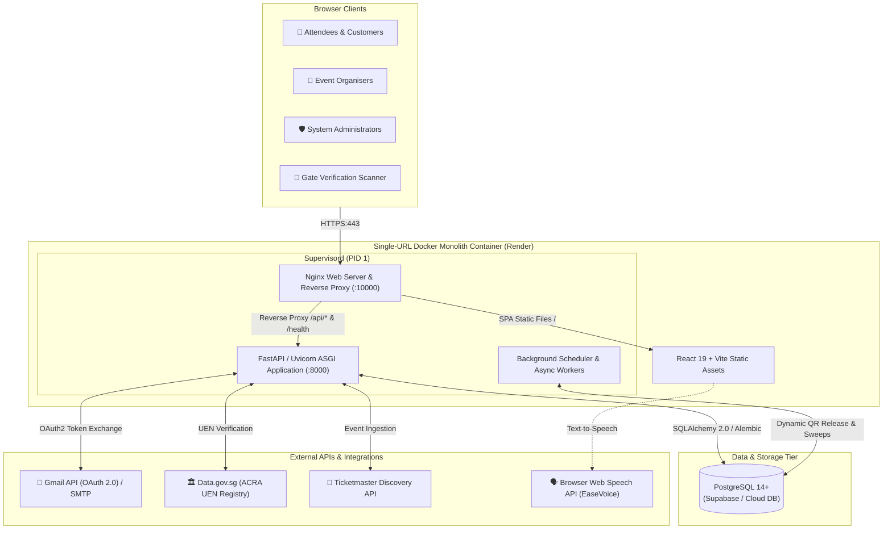

# EventEase 🎟️

[](https://react.dev/)
[](https://www.typescriptlang.org/)
[](https://vitejs.dev/)
[](https://tailwindcss.com/)
[](https://fastapi.tiangolo.com/)
[](https://www.python.org/)
[](https://www.postgresql.org/)
[](https://www.sqlalchemy.org/)
[](https://www.docker.com/)
[](https://render.com/)

**EventEase** is an accessible, enterprise-grade, full-stack event discovery, ticketing, and venue operations platform engineered for concerts, theatre, sports, and cultural festivals in Singapore. Built with a high-performance **React 19** frontend and a robust **FastAPI + PostgreSQL** backend, EventEase combines attendee accessibility with concurrency-safe reservations, dynamic anti-scalping QR releases, fair peer-to-peer ticket exchanges, and multi-tenant organiser governance.

---

### 🌐 Live Production Deployment

EventEase is deployed as an enterprise single-container monolith on **Render**:

| Service | Endpoint | Description |
| :--- | :--- | :--- |
| **Live Web Platform** | [https://eventease-ggz2.onrender.com](https://eventease-ggz2.onrender.com) | Unified React 19 SPA & Public Portals |
| **Interactive API Docs** | [https://eventease-ggz2.onrender.com/api/docs](https://eventease-ggz2.onrender.com/api/docs) | OpenAPI / Swagger interactive documentation |
| **System Health Check** | [https://eventease-ggz2.onrender.com/health](https://eventease-ggz2.onrender.com/health) | Uvicorn & database connectivity probe |

---

## 📑 Table of Contents

- [Architectural Overview](#-architectural-overview)
- [Key Features & Capabilities](#-key-features--capabilities)
  - [Concurrency-Safe Seating & Ticketing Engine](#1-concurrency-safe-seating--ticketing-engine)
  - [Dynamic Anti-Scalping QR Release & Gate Scanner](#2-dynamic-anti-scalping-qr-release--gate-scanner)
  - [Inclusive Design: EaseVoice & Adaptive UI](#3-inclusive-design-easevoice--adaptive-ui)
  - [EaseXchange Fair Ticket Resale & Transfers](#4-easexchange-fair-ticket-resale--transfers)
  - [Multi-Tenant Organisations & Team Operations](#5-multi-tenant-organisations--team-operations)
  - [Enterprise Security, Fraud Guard & PDPA Compliance](#6-enterprise-security-fraud-guard--pdpa-compliance)
  - [Time-Travel Clock Simulation & Developer Tools](#7-time-travel-clock-simulation--developer-tools)
  - [Community Forum, EasePoints & Knowledge Base](#8-community-forum-easepoints--knowledge-base)
- [Technology Stack](#-technology-stack)
- [Domain Architecture & SOLID Foundations](#-domain-architecture--solid-foundations)
- [Directory Structure](#-directory-structure)
- [Role-Based Access Control (RBAC)](#-role-based-access-control-rbac)
- [Quick Start & Local Development](#-quick-start--local-development)
  - [Prerequisites](#prerequisites)
  - [Method 1: Docker Compose (Recommended)](#method-1-docker-compose-recommended)
  - [Method 2: Native Local Development](#method-2-native-local-development)
  - [Default Test Credentials](#default-test-credentials)
- [Server-Side CLI Commands](#-server-side-cli-commands)
- [Environment Variables Configuration](#-environment-variables-configuration)
- [RESTful API Reference](#-restful-api-reference)
- [Testing & Quality Assurance](#-testing--quality-assurance)
- [Production Monolith Architecture](#-production-monolith-architecture)
- [License & Academic Attribution](#-license--academic-attribution)

---

## 🏗️ Architectural Overview

EventEase runs as a **Single-URL Full-Stack Monolith Container**. A production **Nginx** reverse proxy binds to the public port (`10000`), routing static single-page application requests to the pre-rendered React 19 bundle and proxying `/api/*` and `/health` requests directly to **Uvicorn / FastAPI** running under **Supervisord (PID 1)**.



---

## 🌟 Key Features & Capabilities

### 1. Concurrency-Safe Seating & Ticketing Engine
- **Atomic Database Locks**: Prevents double-booking during high-demand on-sales via PostgreSQL row-level locks (`SELECT ... FOR UPDATE`).
- **10-Minute Hold Expiry**: Temporary reservation holds automatically roll back to inventory if the checkout is abandoned, managed by a lightweight 30-second sweep worker.
- **Interactive Venue Seating**: Dynamic SVG-rendered seat maps supporting multi-category tiers (VIP, Category 1, Category 2, Accessible Companion Seating), pricing tiers, and capacity quotas.
- **Anti-Scalping Purchase Quotas**: Strict limit enforced per attendee per event (default: max 6 tickets) to curb automated scalper accumulation.

### 2. Dynamic Anti-Scalping QR Release & Gate Scanner
- **Time-Delayed QR Pass Release**: Tickets remain encrypted and locked without scannable QR passes until the configured release window (e.g., 7 days or 24 hours prior to event start), neutralizing secondary scalping markets and counterfeit ticket distribution.
- **Automated QR Dispatch Worker**: Asynchronous scheduler job (`QR_RELEASE`) automatically generates scannable `qrcode` payloads, updates ticket statuses to `RELEASED`, and dispatches branded transactional emails.
- **Branded Email Delivery**: Responsive HTML email templates with embedded digital QR passes co-branded with EventEase and partner logos.
- **Instant Gate Scanner (`/verify/:ref`)**: Turnstile gate operators can authenticate entry passes using live camera QR scanning or manual reference lookup. Features instant one-click pass redemption (`CLAIMED`), tamper verification, and duplicate check prevention.

### 3. Inclusive Design: EaseVoice & Adaptive UI
- **EaseVoice Narration**: Integrated Web Speech API audio narration for event descriptions, schedules, seat categories, and checkout summaries—empowering visually impaired attendees.
- **Adaptive Contrast Modes**: Real-time switching between Standard, High-Contrast Light, and High-Contrast Dark themes.
- **Dyslexia-Friendly Typography**: Accessible typography toggle (`OpenDyslexic` and high-legibility sans-serif fonts) with dynamic text-scaling sliders.
- **On-Site Assistance Queue**: End-to-end workflow enabling attendees to request accommodations (wheelchair space, audio induction loops, guide dog clearance, companion seating, sign language interpreters) linked directly to their booking for venue operators to fulfill.

### 4. EaseXchange Fair Ticket Resale & Transfers
- **Ethical Resale Marketplace**: Attendees unable to attend can list their tickets for resale strictly capped at original face value—eliminating price gouging.
- **Atomic Transfer & Pass Invalidation**: Once an exchange is matched and confirmed, the original ticket QR pass is permanently revoked, and an authentic new pass with a unique cryptographic reference is minted for the recipient.

### 5. Multi-Tenant Organisations & Team Operations
- **Singapore ACRA UEN Validation**: Integrates with Data.gov.sg ACRA registry to verify business entity legitimacy when organizers register.
- **Multi-Tenant Team Management**: Organisers can invite team members with granular roles (`MANAGER`, `MEMBER`), delegate event management, and switch active organisations seamlessly.
- **Live Operations Seat Map**: Organisers view real-time venue occupancy, booked seats, and check-in statuses visually during live events.
- **Comprehensive Reporting**: Export event financial performance, attendance metrics, and inventory distribution to downloadable CSV and formatted PDF reports.

### 6. Enterprise Security, Fraud Guard & PDPA Compliance
- **Dual-Token Authentication**: 15-minute cryptographically signed JWT access tokens paired with secure HTTP-only refresh cookies (`SameSite=Lax`).
- **Heuristic Fraud Detection**: Automated monitoring flag signals including rapid-fire IP signups, abnormal payment failure bursts, multiple accounts sharing phone numbers, and abnormal cancellation-to-booking ratios.
- **Brute-Force & Credential Stuffing Defenses**: Dynamic IP and account rate limiters, lockout penalties after 5 consecutive failures, and account protection rules.
- **Singapore PDPA Compliance**: Automated data retention sweeper (`purge-old-data`) purges sensitive IP history and expired session metadata older than 90 days, with PII masking across administrative interfaces.

### 7. Time-Travel Clock Simulation & Developer Tools
- **Live Clock Simulation**: Administrators can fast-forward or rewind platform time in test environments to observe scheduled jobs, ticket release windows, hold expirations, and cancellation policies in real time without waiting days.
- **Interactive Scheduler Job Trigger**: Execute background jobs (`QR_RELEASE`, `HOLD_SWEEP`, `RETENTION_PURGE`) on demand and monitor execution runtimes, thread counts, and status logs in the Admin Dashboard.
- **Demo Data Resets**: Isolated sandbox reset controls to restore pristine baseline states for testing and grading demonstrations.

### 8. Community Forum, EasePoints & Knowledge Base
- **Event Community**: Event-specific discussion threads and attendee forums for ride-sharing, fan meetups, and venue tips.
- **EasePoints Loyalty**: Reward system awarding loyalty points on ticket purchases, redeemable for platform perks.
- **EaseHelp Center**: Searchable knowledge base and FAQ repository with categorized guidance on booking, accessibility, cancellations, and ticketing rules.

---

## 🛠️ Technology Stack

| Layer | Technology | Version | Purpose |
| :--- | :--- | :--- | :--- |
| **Frontend Framework** | [React](https://react.dev/) | `19.0.0` | Concurrent UI rendering & state orchestration |
| **Language** | [TypeScript](https://www.typescriptlang.org/) | `5.7` | End-to-end static typing across UI components |
| **Build Tooling** | [Vite](https://vitejs.dev/) | `6.0` | Ultra-fast HMR and optimized production bundling |
| **Routing** | [React Router](https://reactrouter.com/) | `7.1` | Declarative client-side routing & navigation guards |
| **CSS Framework** | [Tailwind CSS](https://tailwindcss.com/) | `4.0` | Modern, utility-first styling with `@tailwindcss/vite` |
| **Icons & Visuals** | [Lucide React](https://lucide.dev/) | Latest | Clean, accessible iconography |
| **Backend Framework** | [FastAPI](https://fastapi.tiangolo.com/) | `0.115` | High-throughput asynchronous Python REST API |
| **Language Runtime** | [Python](https://www.python.org/) | `3.12` | Modern backend runtime with type hints |
| **Data Validation** | [Pydantic](https://docs.pydantic.dev/) | `v2` | Strict schema validation and settings parsing |
| **Database & ORM** | [PostgreSQL](https://www.postgresql.org/) + [SQLAlchemy](https://www.sqlalchemy.org/) | `14+` / `2.0` | Relational storage with async-capable ORM models |
| **Schema Migrations** | [Alembic](https://alembic.sqlalchemy.org/) | `1.14` | Version-controlled database schema migrations |
| **Process Manager** | [Supervisord](http://supervisord.org/) | Latest | Process orchestration for Nginx + Uvicorn under PID 1 |
| **Web Server / Proxy** | [Nginx](https://nginx.org/) | Alpine | High-performance SPA server & reverse proxy |
| **Containerization** | [Docker](https://www.docker.com/) | Multi-stage | Single-container full-stack deployment artifact |
| **Hosting Platform** | [Render](https://render.com/) | Native Docker | Monolith web service with automated health checks |
| **Email Transports** | Gmail API (OAuth 2.0) / SMTP | — | Dual mailer engine for reliable transactional emails |
| **Testing Framework** | [pytest](https://pytest.org/) | `8.3` | Comprehensive unit, integration, and architecture tests |

---

## 🏛️ Domain Architecture & SOLID Foundations

The EventEase codebase is structured around **Clean Architecture** and strict **SOLID** principles, organized into distinct packages:

```text
Package A: Authentication, RBAC & PDPA Governance
  ├── Single-responsibility authentication & token issuance services
  ├── Strict role isolation (Customer, Organiser, Admin)
  └── PDPA data-minimisation & retention purge policies

Package B: Concurrency-Safe Ticketing & Seating
  ├── Open-Closed Principle (OCP) seat allocation strategies
  ├── Atomic row-level lock concurrency & 10-minute hold rollbacks
  └── Configurable anti-scalping purchase quotas

Package C: Moderation & Ingestion Pipelines
  ├── Dependency Inversion (DIP) external ingestion adapters
  ├── Ticketmaster Discovery API & CSV/JSON bulk import modules
  └── Administrative review, approval, and suspension workflows

Package D: Inclusive Accessibility (EaseVoice)
  ├── Web Speech API speech synthesis integration
  ├── WCAG AAA high-contrast modes, typography scaling, & Dyslexic fonts
  └── Dedicated on-site accommodation coordination queue

Package E: Operational Excellence & Resale
  ├── Dynamic anti-scalping QR pass release scheduler
  ├── EaseXchange fair peer-to-peer resale mechanics
  ├── Heuristic fraud detection & anomaly alerting
  └── Multi-tenant organisation governance & ACRA UEN verification
```

---

## 📂 Directory Structure

```text
EventEase/
├── README.md                           # Master project documentation
└── project/                            # Main application root
    ├── Dockerfile                      # Multi-stage production container build
    ├── docker-compose.yml              # Local multi-service development orchestration
    ├── render.yaml                     # Render Blueprint monolith infrastructure spec
    │
    ├── backend/                        # FastAPI Python application
    │   ├── alembic/                    # Database schema migration revisions
    │   │   └── versions/
    │   ├── app/
    │   │   ├── api/v1/                 # Versioned REST endpoints
    │   │   │   ├── admin.py            # Event approvals, user audits, fraud signals
    │   │   │   ├── assistance.py       # Accessibility assistance requests
    │   │   │   ├── auth.py             # Login, signup, refresh, password recovery
    │   │   │   ├── bookings.py         # Reservation, payment, hold management
    │   │   │   ├── community.py        # Event discussion boards
    │   │   │   ├── developer.py        # Clock simulation & scheduler controls
    │   │   │   ├── events.py           # Catalog search & event details
    │   │   │   ├── exchanges.py        # EaseXchange resale endpoints
    │   │   │   ├── help.py             # Knowledge base & FAQs
    │   │   │   ├── organisations.py    # UEN check, organisation onboarding
    │   │   │   ├── organiser.py        # Organiser event creation & sales tracking
    │   │   │   └── tickets.py          # QR pass issuance & gate verification
    │   │   ├── core/                   # Security, JWT, config, rate limiting
    │   │   ├── db/                     # SQLAlchemy models, sessions, engine setup
    │   │   ├── rules/                  # Domain business logic & validation rules
    │   │   ├── schemas/                # Pydantic v2 request & response schemas
    │   │   ├── services/               # Core business services
    │   │   │   ├── bookings/           # Dynamic QR release & seat hold sweepers
    │   │   │   ├── ingestion/          # Ticketmaster & external sync adapters
    │   │   │   ├── mail/               # Gmail API & SMTP transactional mailers
    │   │   │   └── reports/            # CSV/PDF reporting engines
    │   │   ├── cli.py                  # Administrative CLI commands
    │   │   └── main.py                 # FastAPI application factory
    │   ├── tests/                      # Pytest suite
    │   │   ├── unit/                   # Isolated component and rule tests
    │   │   └── integration/            # End-to-end API and workflow tests
    │   ├── alembic.ini                 # Alembic configuration
    │   └── requirements.txt            # Python dependencies
    │
    ├── frontend/                       # React 19 + TypeScript + Vite SPA
    │   ├── src/
    │   │   ├── components/             # Reusable UI primitives
    │   │   │   ├── analytics/          # EaseAnalytics performance charts
    │   │   │   ├── assistance/         # Accessibility queue components
    │   │   │   ├── seating/            # SeatMap, OperationsSeatMap, VenueSetup
    │   │   │   └── voice/              # EaseVoice speech controls
    │   │   ├── lib/                    # API client (backendApi.ts), auth, state
    │   │   ├── pages/                  # Application views
    │   │   │   ├── AdminDashboard.tsx  # Platform administration view
    │   │   │   ├── Browse.tsx          # Event search catalog with filters
    │   │   │   ├── CustomerDashboard.tsx # Attendee tickets & assistance
    │   │   │   ├── EventDetail.tsx     # Seating layout & checkout hold flow
    │   │   │   ├── Home.tsx            # Landing page with hero & categories
    │   │   │   ├── OrganizerDashboard.tsx # Sales analytics & event setup
    │   │   │   └── Verify.tsx          # Turnstile gate pass validator
    │   │   ├── routes.tsx              # React Router 7 route definitions
    │   │   └── App.tsx                 # Root layout & providers
    │   ├── package.json                # Frontend dependencies and build scripts
    │   └── vite.config.ts              # Vite configuration with Tailwind CSS v4
    │
    └── monolith/                       # Production container orchestration
        ├── nginx.conf                  # Nginx reverse proxy routing
        └── supervisord.conf            # Dual-daemon PID 1 configuration
```

---

## 👥 Role-Based Access Control (RBAC)

EventEase enforces strict role-based separation:

| Role | Portal Route | Primary Capabilities |
| :--- | :--- | :--- |
| **`CUSTOMER`** | `/dashboard/customer` | Browse catalog, select seats with 10-min hold, checkout, view passes with dynamic QR release, request on-site accessibility assistance, cancel eligible bookings (48h cutoff), list tickets on EaseXchange, earn EasePoints. |
| **`ORGANISER`** | `/dashboard/organizer` | Register organisation with ACRA UEN lookup, invite team members, build venue seating layouts, configure ticket tier pricing and quotas, monitor live venue occupancy via `OperationsSeatMap`, process assistance requests, download CSV/PDF sales reports. |
| **`ADMIN`** | `/dashboard/admin` | Moderate pending events (Approve / Reject / Suspend), bulk import external events (CSV / JSON / Ticketmaster), manage users and account suspensions, audit fraud signals and security logs, trigger background scheduler jobs, control time-travel clock simulation. |
| **`GATE STAFF`** | `/verify/:ref` | Public turnstile verification view with live camera QR scanning and manual reference lookup to validate and claim attendee tickets at the venue door. |

---

## 🚀 Quick Start & Local Development

### Prerequisites
- **Node.js**: `v20.x` or higher & `npm`
- **Python**: `3.12.x`
- **PostgreSQL**: `14+` (Local server or hosted instance)
- **Docker & Docker Compose**: (Optional, for containerized execution)

---

### Method 1: Docker Compose (Recommended)

Spin up the entire application stack (PostgreSQL database + Full-stack Monolith container) with one command:

```bash
# Navigate to the project root
cd project

# Build and start all services
docker compose up --build
```

Access the services:
- **Web Application**: [http://localhost:10000](http://localhost:10000)
- **Interactive Swagger Docs**: [http://localhost:10000/api/docs](http://localhost:10000/api/docs)
- **PostgreSQL Database**: `localhost:5432`

---

### Method 2: Native Local Development

Run the frontend and backend in independent development servers with hot reload.

#### 1. Backend Setup

```bash
# Navigate to the backend directory
cd project/backend

# Create and activate a Python virtual environment
python -m venv .venv
# On Windows:
.venv\Scripts\activate
# On macOS/Linux:
source .venv/bin/activate

# Install dependencies
pip install -r requirements.txt

# Configure your environment file
cp .env.example .env
# Edit .env with your local PostgreSQL credentials and a secure JWT_SECRET

# Apply database migrations
alembic upgrade head

# Seed initial admin account and optional sample events
python -m app.cli seed-admin
python -m app.cli seed-eventease
python -m app.cli seed-sample

# Start the FastAPI development server
uvicorn app.main:app --reload --port 8000
```

Interactive documentation is available at: **`http://localhost:8000/api/docs`**

#### 2. Frontend Setup

```bash
# In a new terminal, navigate to the frontend directory
cd project/frontend

# Install dependencies
npm install

# Start the Vite development server
npm run dev
```

The frontend will run at: **`http://localhost:5173`** (automatically proxies API requests to port `8000`).

---

### Default Test Credentials

When initialized using `python -m app.cli seed-admin` or via the automated seeding pipeline:

| Account Type | Username | Password | Notes |
| :--- | :--- | :--- | :--- |
| **System Admin** | `system_admin` | Configured in `ADMIN_PASSWORD` (or generated upon first seed) | Full governance and developer permissions |
| **EventEase Manager** | `admin_eventease` | Configured in `EVENTEASE_MANAGER_PASSWORD` | Manages internal platform events and venues |
| **Sample Customer** | Register via `/signup` | Any password satisfying security rules | Standard customer permissions |

---

## 💻 Server-Side CLI Commands

EventEase provides administrative commands via `python -m app.cli`:

```bash
# Seed the default administrator account (idempotent)
python -m app.cli seed-admin

# Reset administrator password and force change upon next login
python -m app.cli admin-reset-password --username system_admin

# Seed EventEase self-managed organisation and manager account
python -m app.cli seed-eventease

# Seed sample events for development testing (blocked in production)
python -m app.cli seed-sample

# Purge personal authentication data older than DATA_RETENTION_DAYS (PDPA compliance)
python -m app.cli purge-old-data

# Send email verification reminders to accounts with unconfirmed emails
python -m app.cli send-verification-reminders --send

# Dispatch a test email using the configured MAIL_TRANSPORT
python -m app.cli send-test-email --to recipient@example.com --subject "EventEase Test"

# Authorize Gmail API OAuth 2.0 (one-time consent to generate refresh token)
python -m app.cli gmail-authorize --client-secrets client_secret.json --save
```

---

## ⚙️ Environment Variables Configuration

All configuration is driven through environment variables defined in `project/backend/.env`:

| Variable | Default | Purpose & Description |
| :--- | :--- | :--- |
| `APP_ENV` | `development` | Operating environment (`development`, `test`, `production`) |
| `DATABASE_URL` | — | Full PostgreSQL connection URL (takes precedence over `DB_*` flags) |
| `DB_HOST` | `localhost` | PostgreSQL host |
| `DB_PORT` | `5432` | PostgreSQL port |
| `DB_NAME` | `eventease_db` | Database name |
| `DB_USER` | — | Database user |
| `DB_PASSWORD` | — | Database password |
| `DB_SSLMODE` | `require` | SSL mode (`require` for cloud databases, `disable` for local dev) |
| `JWT_SECRET` | — | Cryptographic secret for signing JWT tokens (min 32 characters) |
| `ACCESS_TOKEN_TTL_MINUTES` | `15` | Access token lifespan before refresh is required |
| `REFRESH_TOKEN_TTL_DAYS` | `7` | Refresh cookie lifespan |
| `FRONTEND_URL` | `http://localhost:5173` | Public origin used for email validation links and password resets |
| `CORS_ORIGIN_REGEX` | `https://([a-z0-9-]+\.)*onrender\.com` | Allowed CORS origins for external consumers |
| `PURCHASE_LIMIT_PER_EVENT`| `6` | Maximum tickets a single customer can purchase per event |
| `BOOKING_HOLD_MINUTES` | `10` | Temporary reservation hold duration before automatic inventory release |
| `CANCELLATION_CUTOFF_HOURS`| `48` | Cancellation deadline prior to event start |
| `SALES_CLOSE_DAYS_BEFORE_EVENT`| `7` | Cutoff period when ticket sales freeze and dynamic QR passes release |
| `MAIL_TRANSPORT` | `console` | Email provider (`console`, `smtp`, `gmail_api`, `sendgrid`, `resend`) |
| `SMTP_HOST` | `smtp.gmail.com` | SMTP server address |
| `SMTP_PORT` | `465` | SMTP port (`465` for SSL, `587` for STARTTLS) |
| `SMTP_USERNAME` | — | SMTP account username / email address |
| `SMTP_PASSWORD` | — | SMTP application password (never commit to git) |
| `GMAIL_CLIENT_ID` | — | Google Cloud OAuth Client ID for Gmail API mailer |
| `GMAIL_CLIENT_SECRET` | — | Google Cloud OAuth Client Secret |
| `GMAIL_REFRESH_TOKEN` | — | Google Cloud OAuth Refresh Token |
| `PAYMENT_PROVIDER` | `mock` | Payment gateway integration (`mock` or `stripe`) |
| `DATA_GOV_SG_API_KEY` | — | Optional API key for live ACRA Singapore business entity queries |
| `TICKETMASTER_API_KEY` | — | Optional API key for syncing external Ticketmaster Singapore listings |
| `DATA_RETENTION_DAYS` | `90` | Singapore PDPA retention window for login logs and IP records |

---

## 📡 RESTful API Reference

The backend provides versioned endpoints prefixed with `/api/v1`. Full schema definitions and interactive tests are available at `/api/docs`.

### Authentication & Account (`/api/v1/auth`)
- `POST /login` — Authenticate credentials; sets HTTP-only refresh cookie and returns JWT access token.
- `POST /signup` — Register a customer or submit an organiser application.
- `GET /username-available` — Real-time validation of username uniqueness.
- `POST /refresh` — Issue fresh access token using secure refresh cookie.
- `POST /logout` — Invalidate session and revoke refresh cookie.
- `POST /forgot-password` & `POST /reset-password` — Password recovery flow.
- `POST /change-password` 🔒 — Mandatory or voluntary password rotation.

### Events Catalog (`/api/v1/events`)
- `GET /events` — Public event search with filters: query, category, area, date range, price min/max, and pagination.
- `GET /events/{id}` — Retrieve detailed event specification, venue layout, pricing tiers, and real-time seat availability.

### Bookings & Ticketing (`/api/v1`)
- `POST /bookings` 🔒 — Reserve seats with atomic row locking and a 10-minute hold (supports `Idempotency-Key`).
- `POST /bookings/{id}/pay` 🔒 — Confirm simulated or Stripe payment and finalize reservation.
- `GET /me/bookings` 🔒 — List customer's active passes and order history.
- `POST /me/bookings/{id}/cancel` 🔒 — Self-serve cancellation, releasing seats and initiating refund.
- `GET /verify/{ref}` — Gate verification endpoint; inspects pass validity and prevents reuse.
- `POST /verify/{ref}/claim` 🔒 — Turnstile redemption marking pass as `CLAIMED`.

### Organiser Operations (`/api/v1/organiser`)
- `GET /events` & `POST /events` 🔒 — Manage and publish events.
- `PATCH /events/{id}` 🔒 — Modify event parameters, venue capacity, and dates.
- `POST /events/{id}/ticket-categories` 🔒 — Configure ticket tiers and pricing.
- `GET /events/{id}/sales` 🔒 — Fetch live sales analytics and tier breakdown.
- `GET /events/{id}/operations-seatmap` 🔒 — Real-time venue seat occupancy visualizer.
- `GET /events/{id}/report` 🔒 — Generate and download sales reports (CSV / PDF).

### Organisations & Teams (`/api/v1/organisations`)
- `GET /lookup-uen/{uen}` — Validate Singapore UEN against ACRA database.
- `GET /my` 🔒 — List organisations the signed-in user belongs to.
- `POST /{id}/members` 🔒 — Invite team members and configure organizational roles.

### Ticket Resale & Exchanges (`/api/v1/exchanges`)
- `GET /listings` — View active peer-to-peer ticket resale listings at face value.
- `POST /listings` 🔒 — Post a ticket for verified resale.
- `POST /listings/{id}/buy` 🔒 — Purchase resale ticket; revokes old pass and mints new reference.

### Accessibility & Assistance (`/api/v1/assistance`)
- `POST /requests` 🔒 — Submit specialized on-site accessibility accommodation requests.
- `GET /requests` 🔒 — Organiser queue for reviewing and confirming accommodations.

### System Administration & Moderation (`/api/v1/admin`)
- `GET /events` & `POST /events/{id}/approve|reject|suspend` 🔒 — Event moderation pipeline.
- `POST /events/import` 🔒 — Bulk upload events via CSV or JSON.
- `POST /sources/ticketmaster/sync` 🔒 — Synchronize external events from Ticketmaster.
- `GET /users` & `POST /users/{id}/suspend` 🔒 — Account governance and penalty actions.
- `GET /fraud-signals` & `GET /audit-logs` 🔒 — Platform security and compliance audit logs.

### Developer & Time Travel (`/api/v1/developer`)
- `GET /clock` & `POST /clock/simulate` 🔒 — Time-travel clock simulation for testing.
- `POST /jobs/{job_name}/run` 🔒 — Trigger background scheduler tasks on demand.
- `POST /reset-demo-data` 🔒 — Reset test environment to pristine baseline state.

---

## 🧪 Testing & Quality Assurance

The codebase includes an extensive **pytest** test suite covering unit rules, integration flows, and architecture compliance.

### Running Backend Tests

```bash
cd project/backend

# Run the entire test suite
pytest -v

# Run unit tests only
pytest tests/unit -v

# Run integration tests only
pytest tests/integration -v

# Run SOLID architecture and security compliance tests
pytest tests/unit/test_rules.py tests/unit/test_no_hardcoded_secrets.py -v
```

### Frontend Code Quality & Type Check

```bash
cd project/frontend

# Validate TypeScript types and bundle the production build
npm run build
```

---

## 🚢 Production Monolith Architecture

EventEase is packaged into a high-efficiency container optimized for cloud deployment:

1. **Build Stage (`frontend-builder`)**:
   - Compiles the React 19 application via Vite.
   - Generates optimized static chunks with code-splitting in `/usr/share/nginx/html`.
2. **Runtime Stage (`python:3.12-slim`)**:
   - Installs Nginx and Supervisord.
   - Configures Uvicorn ASGI server to bind internally to `127.0.0.1:8000`.
   - Nginx listens on the public port (`10000`), serving the React SPA with fallback to `index.html` for client-side routing, while reverse-proxying `/api/` and `/health` requests to Uvicorn.
   - **Zero CORS Issues**: Because the React SPA and FastAPI backend share the exact same origin, authentication cookies (`SameSite=Lax`) work reliably without cross-origin friction.

---

## 📄 License & Academic Attribution

This project was developed for the **NTU Mini Capstone (Full Stack) Project (CT2079)**. All rights reserved.

Designed and engineered with a focus on modern web standards, inclusive accessibility, concurrent data integrity, and enterprise software architecture.
